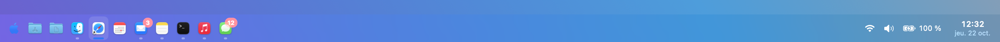
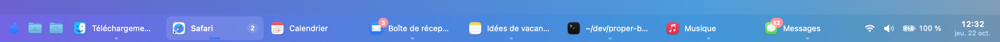
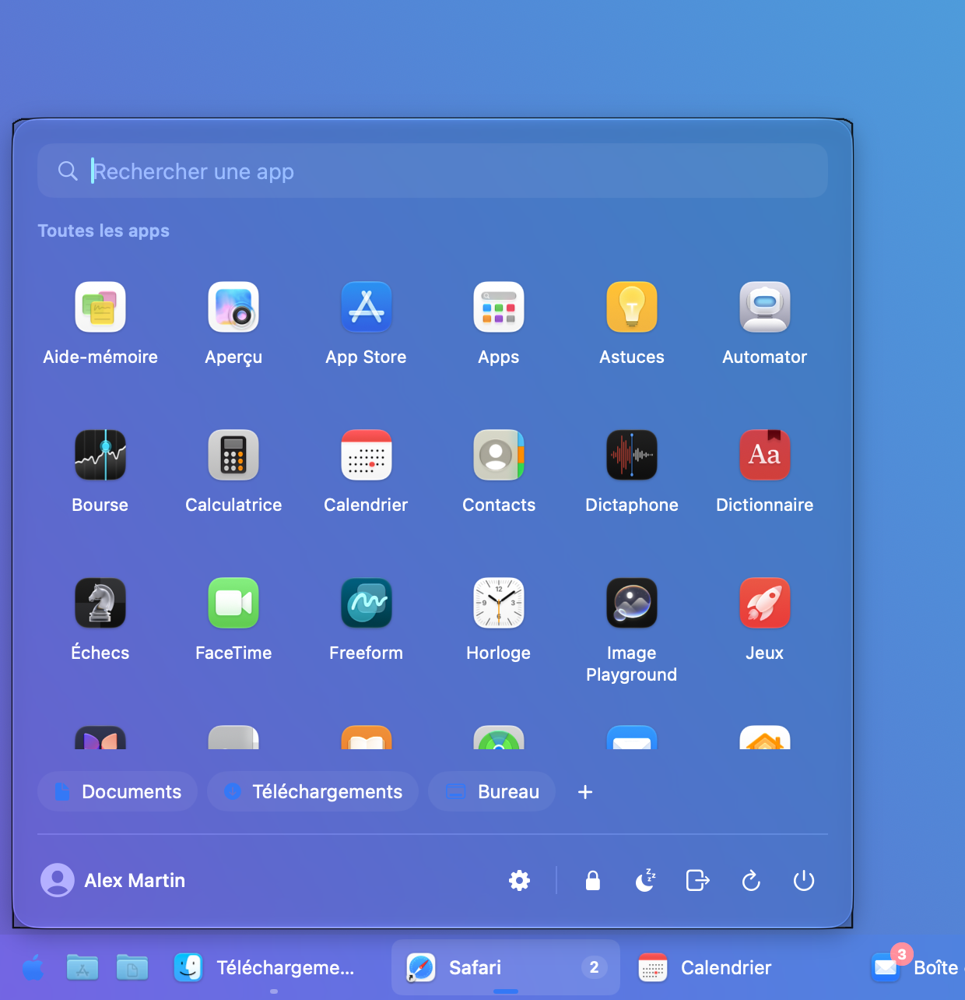
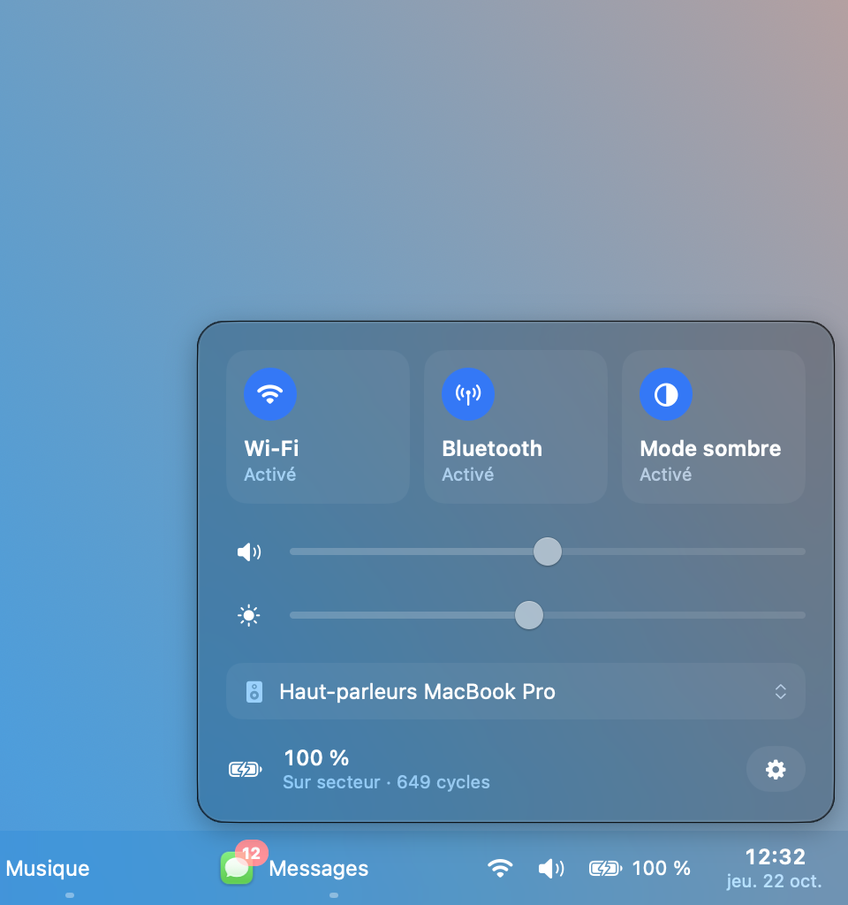
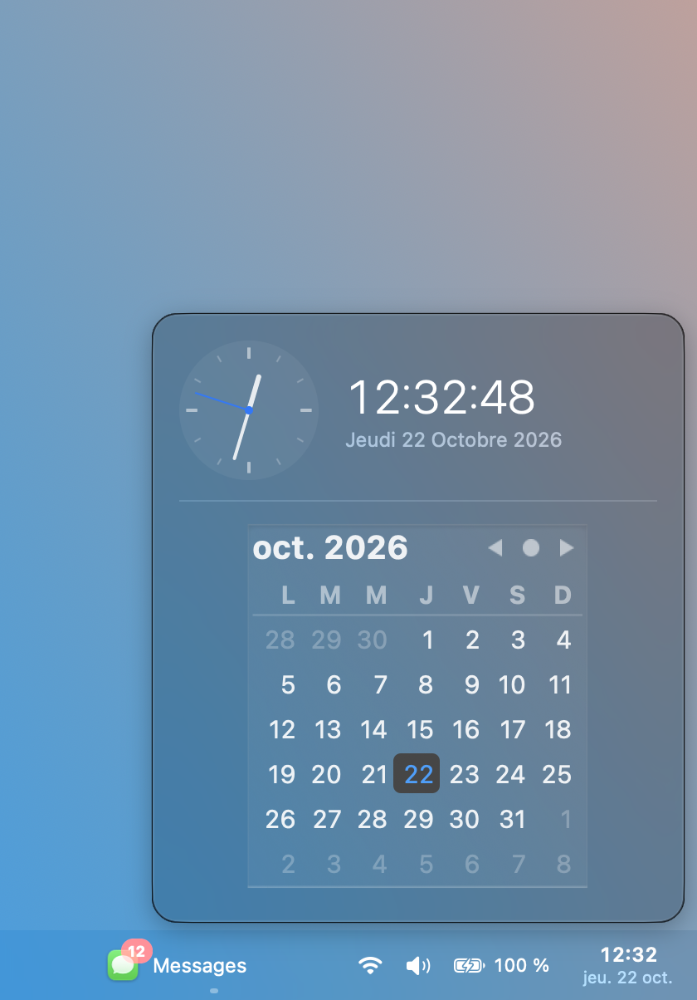

# ProperBar

**A free and open-source taskbar for macOS — an alternative to [uBar](https://ubarapp.com).**

ProperBar replaces the macOS Dock with a full-width bar: a compact **Dock mode** that keeps your launcher, apps, system icons and clock on a single line, or a Windows-style **taskbar mode** with one titled tile per window. Live previews, a launcher with search and power options, quick settings and a calendar come with both. It is written from scratch in Swift (AppKit + SwiftUI), with no dependencies.

### Dock mode



### Taskbar mode



| Launcher | Quick settings | Calendar |
|---|---|---|
|  |  |  |

## Features

- **Dock mode**: icons only, edge to edge, with running indicators and badges — the macOS Dock, plus a launcher, system icons and a clock. Icon size, padding and spacing are adjustable down to the point.
- **Taskbar mode**: titled tiles, on any screen edge, four bar heights, auto-hide.
- **Window tiles**: one per window or one per app, with *Automatic* grouping that folds the busiest apps when the bar runs out of room.
- **Pinned apps** and **favorites** (files and folders, browsable as menus); reorder tiles by drag and drop, drop a file on a tile to open it with that app.
- **Live window previews** on hover, with a close button per window.
- **Launcher** with app search, folder shortcuts and lock / sleep / log out / restart / shut down. Pick its icon (Apple logo, grid, …) or use your own image.
- **Quick settings**: Wi-Fi, Bluetooth, dark mode, volume and mute, display brightness, audio output, battery and charge cycles, eject all disks.
- **Clock** with a calendar and analog clock.
- **Notification badges** mirrored from the Dock, **CPU and memory** per app while holding ⌃.
- **Multiple displays**: one bar per screen showing its own windows, mirrored bars, or a single screen.
- Optionally **hides the macOS Dock** (restored when ProperBar quits) and starts at login.

## Install

Requires macOS 15 or later and a Swift 6 toolchain (Xcode, or just the Command Line Tools: `xcode-select --install`).

```bash
git clone https://github.com/manuelLandreau/proper-bar.git
cd proper-bar
./scripts/build-app.sh
open ~/Applications/ProperBar.app
```

On first launch, grant **Accessibility** (needed to list and control windows) and **Screen Recording** (needed for previews only). The build script signs the app with a local self-signed identity so those grants survive rebuilds.

## Good to know

- macOS has no API to reserve screen space, so a zoomed window can extend under the bar — same as uBar.
- Bluetooth power, display brightness, the window id lookup and screen locking rely on private APIs (the same ones used by blueutil, MonitorControl, AltTab…). They are loaded defensively: if a future macOS removes them, only the matching control disappears.
- The interface is currently in French. English localization is a very welcome first contribution.

## Contributing

Contributions are welcome — bug reports, ideas and pull requests alike. Please open an issue to discuss bigger changes first.

```bash
./scripts/test.sh          # unit tests (tile grouping and ordering)
./scripts/build-app.sh     # build, sign and install the app
open -n ~/Applications/ProperBar.app --args --demo --demo-panel start   # sample data, handy for screenshots
```

`Sources/ProperBarCore` holds the pure tile logic and its tests; `Sources/ProperBar` is the app.

## License

[MIT](LICENSE). ProperBar is an independent project, not affiliated with uBar or its developer.
